Sprache: [English](README.md) | **Deutsch**

  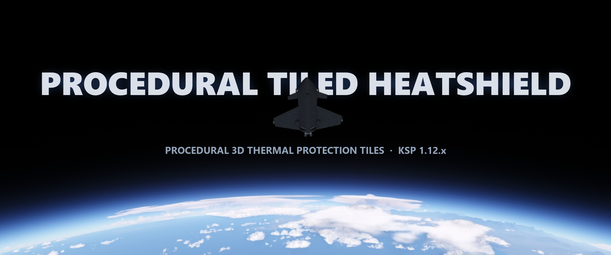

# Procedural Tiled Heatshield

**Procedural Tiled Heatshield** (`AblatorDecals`, **v1.0**) ist ein Mod für **Kerbal Space Program 1.12.x**. Er fügt ein einzelnes, per Surface-Attach anbringbares Part (**Ablative Hitzekacheln**, intern `ablativeDecal`) hinzu, das dünne 3D-Hitzeschutzkacheln prozedural direkt auf den Rumpf legt — im Starship- (Sechsecke) oder Space-Shuttle-Stil (Quadrate).

Thermisch funktioniert das Decal wie ein echtes Ablator-Hitzeschild: Es fängt Konvektionshitze auf der angeströmten Seite ab, verbraucht Ablator passend zu Fläche und Dicke, glüht beim Wiedereintritt und entwickelt danach nahtlose, windgerichtete Verwitterungsstreifen — und bleibt dabei ein einziges Part.

> **Kurzer Hinweis:** Das ist mein allererster KSP-Mod ohne vorherige Modding-Erfahrung. Ich habe ihn ursprünglich nur privat für mich selbst (mit KI-Unterstützung) begonnen, inspiriert durch Matt Lownes Video über selbstgebaute Hitzeschilde aus Decals, und mich dann entschieden, ihn mit der Community zu teilen. Der Mod ist noch **stark in Arbeit (Work in Progress)** — Bugs können durchaus auftreten, also melde sie bitte einfach über [GitHub Issues](https://github.com/timduebi/Procedural-Tiled-Heatshields/issues)! Er wurde vor allem für **Spaceplane-Parts** (Mk1/Mk2/Mk3, Flügel, Klappen, Frachträume, Lufteinlässe, Fahrwerk) entwickelt und funktioniert dort sehr gut. Er geht auch auf anderen Parts (Tanks, Adapter, Kapseln usw.), dort kann es aber durchaus zu Artefakten oder unerwünschten Effekten kommen.

---

## In-Game Screenshots

| | |
|---|---|
| 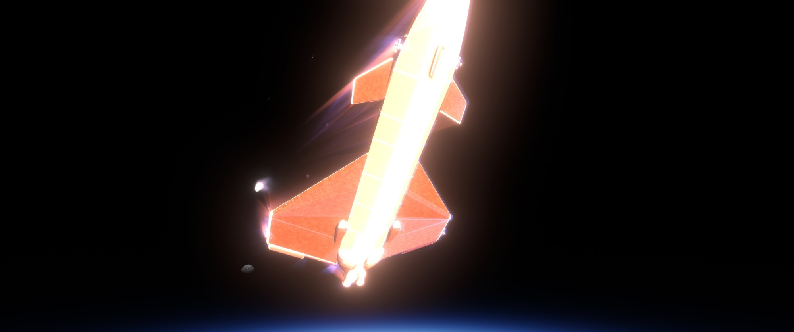 | 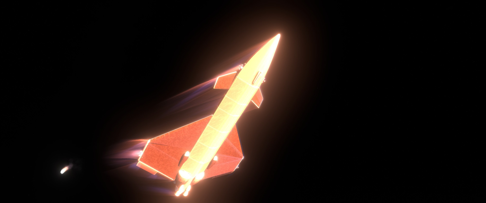 |
| 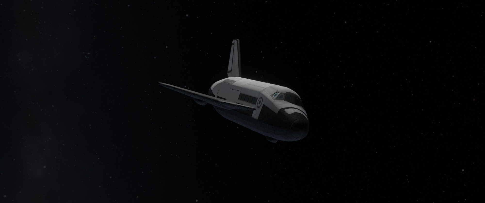 | 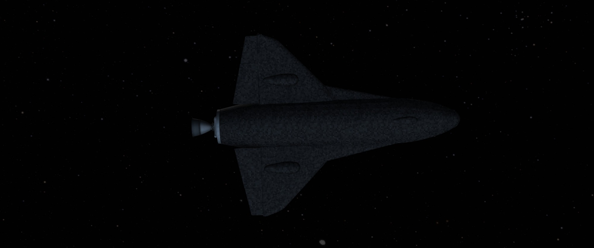 |

  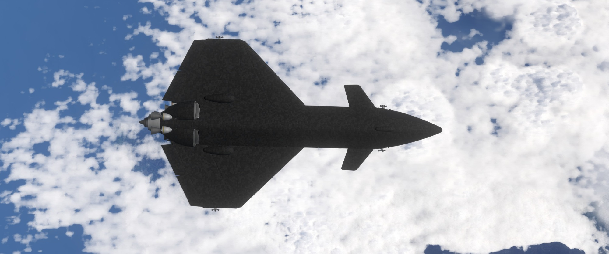

---

## Features & Vorschau

### 6 PBR-Kachelvarianten & prozeduraler Umgriff
Wähle zwischen **Sechsecken** (Starship) und **Quadraten** (Shuttle) in **Schwarz**, **Schlichter Keramik** und **gebürstetem Edelstahl** — mit vollständigen PBR-Metallic-, Roughness- und Normal-Maps (`TU/Metallic`, `Resurfaced/Standard` oder Stock). Umgriffwinkel, bedeckte Höhe, Kachelgröße und Dicke lassen sich live einstellen; Teilnähte, Luken und Fenster werden sauber ausgespart.

| Alle 6 Kachelvarianten | Prozeduraler Umgriff & Höhe |
|---|---|
| 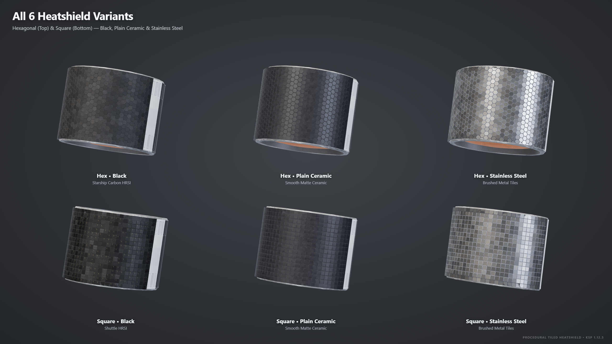 | 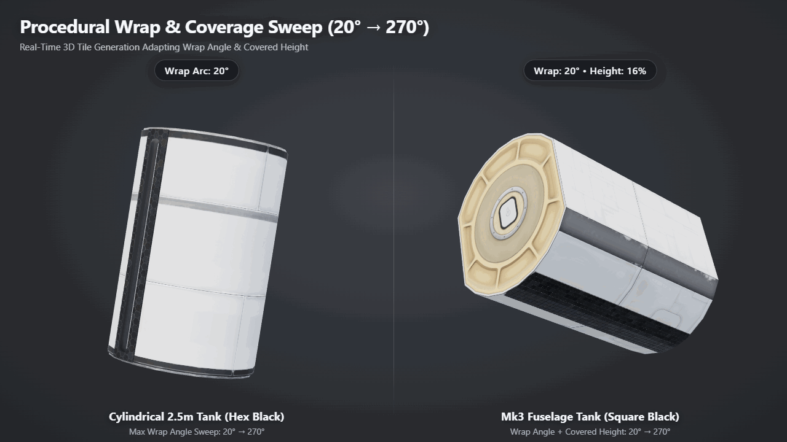 |

### Bewegliche Teile, Frachträume, Lufteinlässe & Fahrwerk
Auf beweglichen Bauteilen fahren die Kacheln sauber mit — bei **Cargo- & Service-Bay-Türen**, **Elevons & Winglets**, **einfahrbarem Fahrwerk** sowie **geschützten Docking-Ports**. **Lufteinlässe** werden außen umhüllt, während die Ansaugöffnungen komplett frei bleiben.

| Cargo- & Service-Bays | Steuerflächen |
|---|---|
| 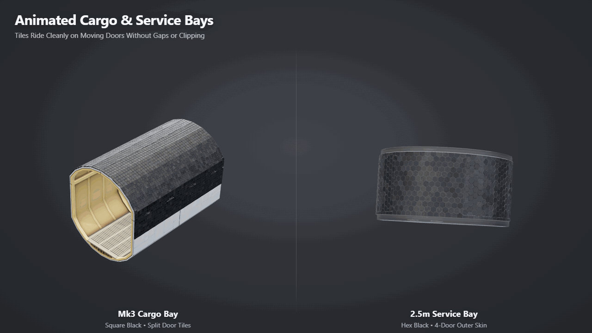 | 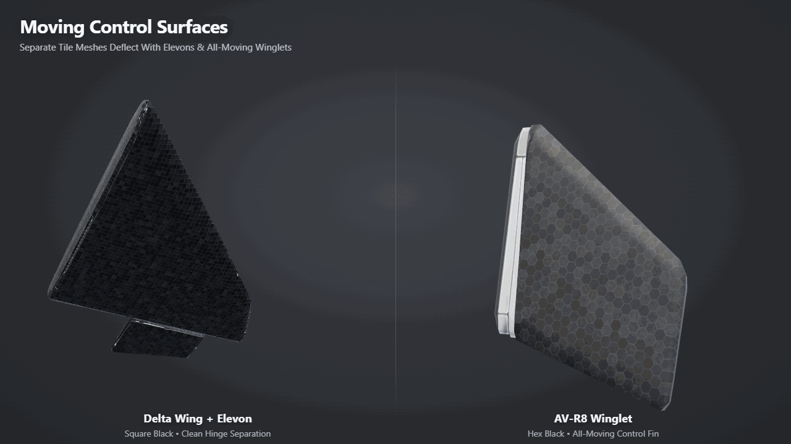 |

| Fahrwerk & Docking-Ports | Lufteinlässe an Flügel & Mk2 |
|---|---|
| 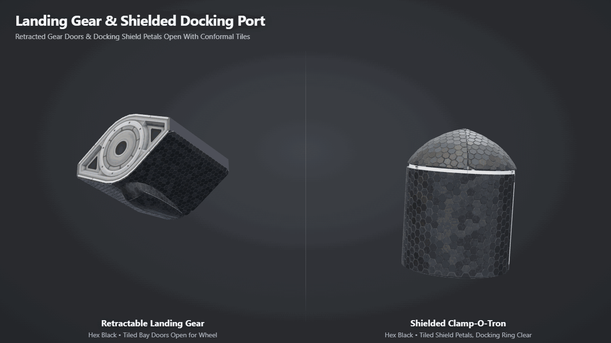 | 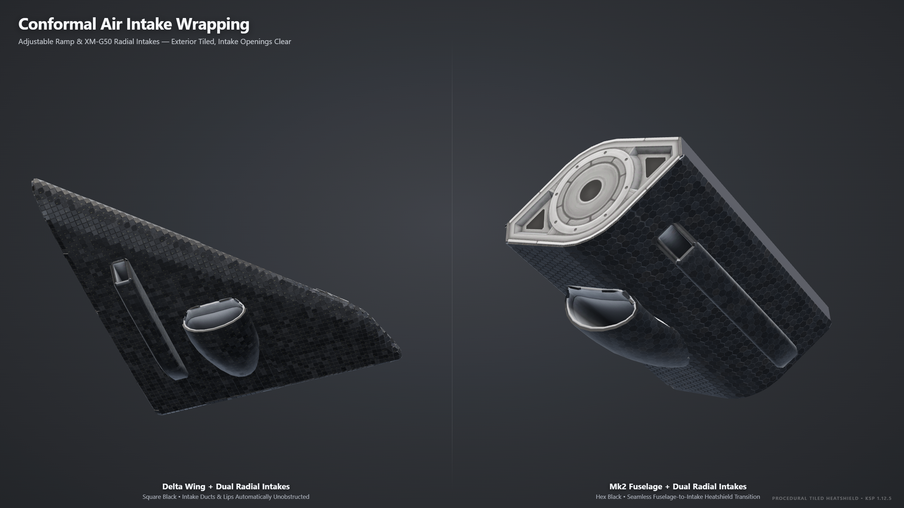 |

### Wiedereintritts-Glühen & Verwitterung
Beim Wiedereintritt glühen die angeströmten Kacheln nahtlos über Teilgrenzen hinweg von Dunkelrot über Orange bis Weißgelb. Sobald das Plasma abkühlt, erscheinen schiffsweite, nahtlose Ruß- und Aschestreifen — gerade von Nase zu Heck über flache Deltaflügel und im Starship-Stil um gewölbte Tank- und Rumpfflanken herum gefächert (auch direkt im VAB per **Verwitterung**-Regler sichtbar), plus optionales Kachel-Abplatzen mit EVA-Reparatur durch Ingenieure.

| Thermisches Glühen | Verwitterung & Windstreifen (0% → 100%) |
|---|---|
| 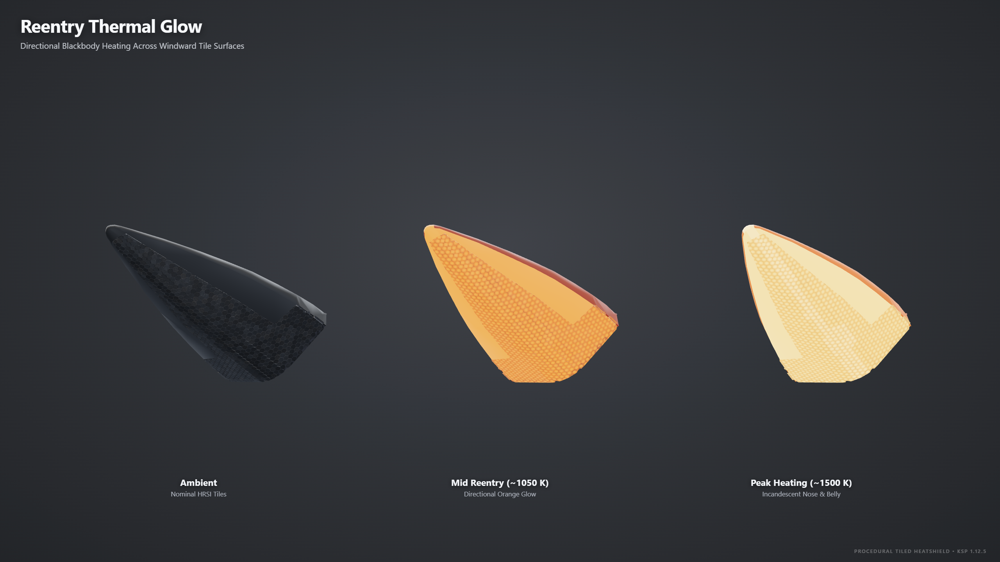 | 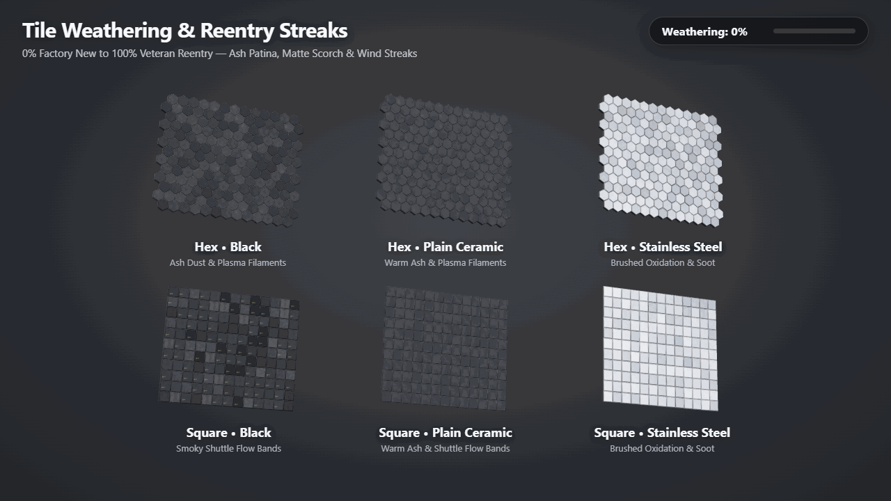 |

### Cockpits, Rümpfe & Tanks
Vorgefertigte Cockpitformen halten Fenster (und Mk2-RCS-Düsen) an Mk1-, Mk2- und Mk3-Cockpits frei; runde Tanks von `0,625 m` bis `5,0 m` werden glatt ummantelt.

| Cockpits | Details & Aussparungen |
|---|---|
| 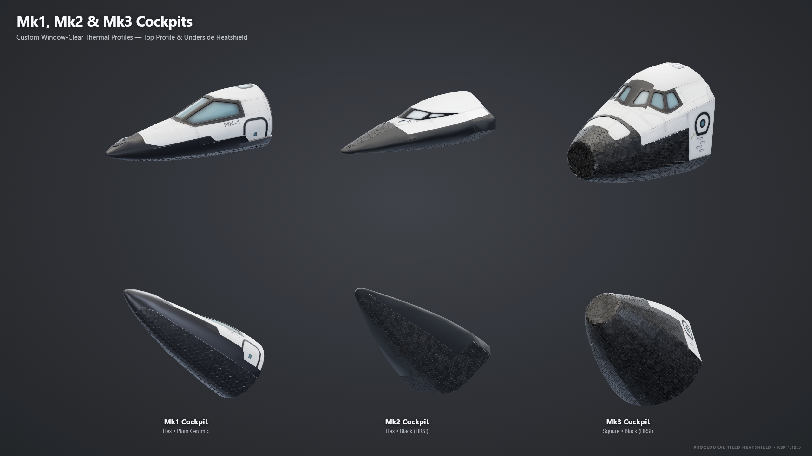 | 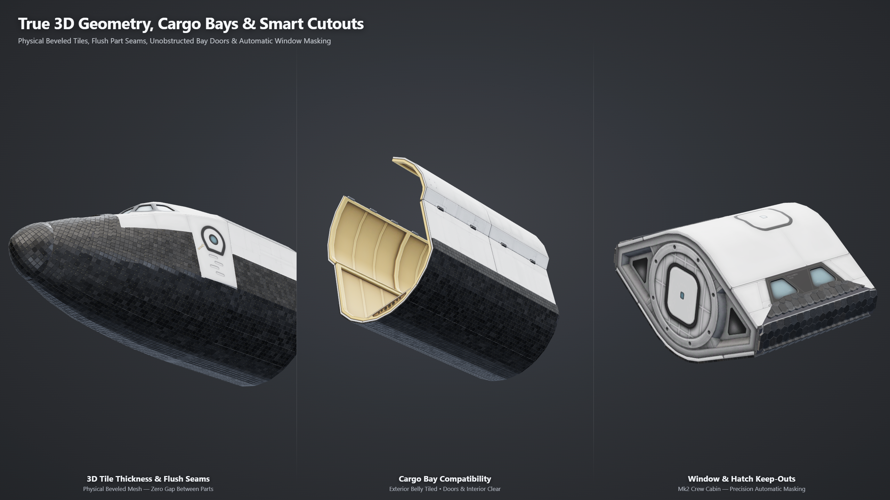 |

<strong>Weitere Part-Übersichten (Mk3-Rumpf, Mk2-Rumpf & Tankgrößen)</strong>

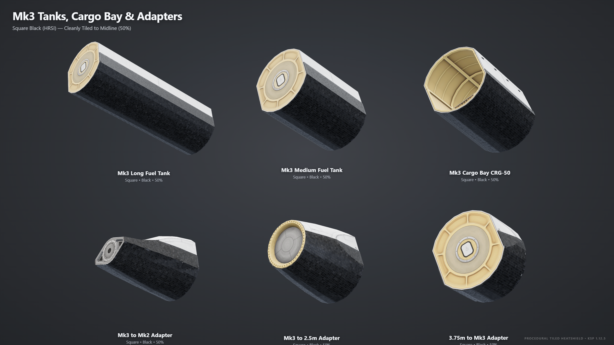
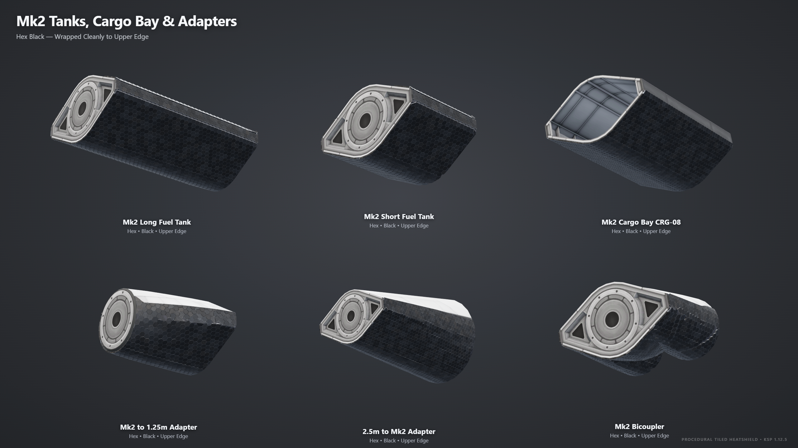
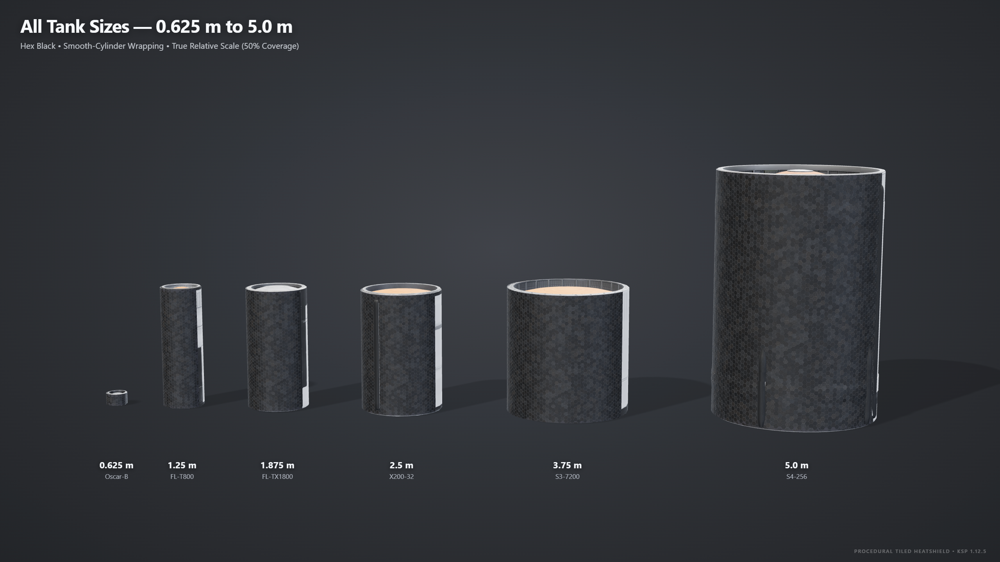

---

## Installation

1. Aktuelles Release-ZIP über [SpaceDock](https://spacedock.info/mod/4884/Procedural%20Tiled%20Heatshield) oder [GitHub Releases](https://github.com/timduebi/Procedural-Tiled-Heatshields/releases) herunterladen.
2. Den Ordner `GameData/AblatorDecals` in dein KSP-`GameData`-Verzeichnis kopieren.
3. **Keine Pflicht-Abhängigkeiten** (läuft direkt auf KSP 1.12.x).

> **Optionale Patches inklusive:** [B9PartSwitch](https://github.com/blowfishpro/B9PartSwitch), **Community Tech Tree** (`heatManagementSystems`), **Deadly Reentry**, **FAR**, **VAB Organizer** sowie **TexturesUnlimited / Resurfaced** (PBR). Getestet mit Stock, Making History, ReStock/ReStockPlus, SSPX und Near Future.

---

## Kurzbedienung

- **Im Editor:** Kategorie **Thermal** (**Ablative Hitzekacheln**, in Wissenschaft/Karriere mit `supersonicFlight` freigeschaltet).
- **Anbringen:** Per Surface-Attach an Rumpf, Flügel, Cockpit, Frachtraum oder Tank kleben — ein Decal deckt sein Teil samt direkt angebauten Steuerflächen, Lufteinlässen und eingefahrenem Fahrwerk ab.
- **Einstellen (PAW):** Muster, Kachelart, Kachelgröße, Dicke (Ablator), Max. Umgriff, Bedeckte Höhe und Kachel-Abplatzen direkt in den Hauptgruppen; Verwitterung, Kachelverlust und Sperrzonen unter *Feinheiten*.
- **Editor-Leiste:** Über den Sechseck-Knopf lassen sich alle Hitzeschilde am Schiff hervorheben, Vorlagen nutzen oder Einstellungen mit einem Klick aufs ganze Schiff anwenden.
- **Teile auf Kacheln setzen:** Radiale Teile (Decoupler, Fahrwerk, Solarpanels, RCS) kleben automatisch am Rumpf darunter und werden um die Kacheldicke nach außen geschoben, ohne mit den Kacheln zu kollidieren.

---

## Dokumentation, Quelltext & Lizenz

- **[SpaceDock-Seite](https://spacedock.info/mod/4884/Procedural%20Tiled%20Heatshield)** — Downloads & CKAN.
- **[KSP-Forum-Thread](https://forum.kerbalspaceprogram.com/topic/232194-112x-procedural-tiled-heatshield-v10-procedural-3d-thermal-protection-tiles-for-spaceplanes-more/)** — Diskussion, Feedback & Screenshots.
- **[Technische Referenz & Config-Übersicht (EN)](docs/REFERENCE.md)** — eigene Texturen, Config-Felder, Thermikmodell und Build-Anleitung.
- **[Changelog](CHANGELOG.de.md)** ([English](CHANGELOG.md)) — vollständige Versionshistorie.
- **[Architektur & Design](docs/ARCHITECTURE.md)** — technische Entwickler-Doku.
- **Lizenz:** [MIT-Lizenz](LICENSE). Eigenständige Umsetzung ohne Code oder Shader aus Conformal Decals.
