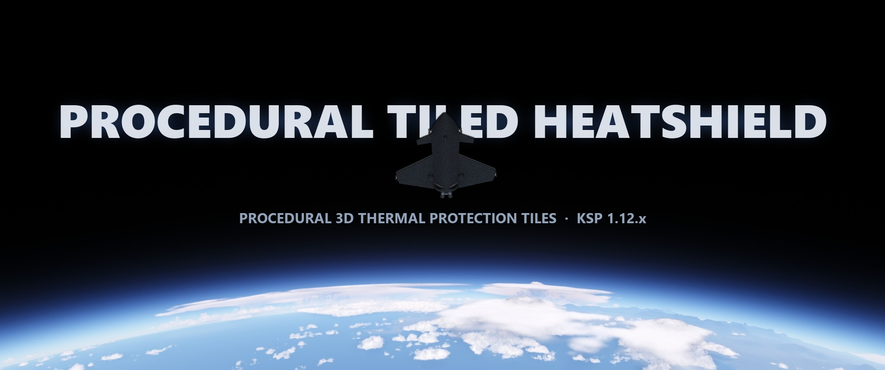

# Release Announcement Posts & Publishing Guide — Procedural Tiled Heatshield (v1.0)

## Where KSP Modders Announce New Mods (Recommended Order)

1. **[SpaceDock](https://spacedock.info)** — Primary community KSP mod host.
   - Upload `dist/AblatorDecals-1.12.0.zip` directly (already uses forward-slash `GameData/AblatorDecals/...` layout).
   - **Check the "Add to CKAN" checkbox** during creation — SpaceDock automatically opens a PR to `KSP-CKAN/NetKAN` so players can install & update via CKAN!
2. **[GitHub Releases](https://github.com/timduebi/Procedural-Tiled-Heatshields/releases)** — Source + release archive (`AblatorDecals-1.12.0.zip`) + `AblatorDecals.version` AVC check URL.
3. **[KSP Official Forum — Add-on Releases](https://forum.kerbalspaceprogram.com/forum/34-ksp1-mod-releases/)** — Main long-term discussion & support thread.
   - **Mandatory Forum Rules Checklist:**
     - `[1.12.x]` in the thread title
     - **License clearly stated** (`MIT License`) in both the post and the ZIP
     - **Source code link** (`https://github.com/timduebi/Procedural-Tiled-Heatshields`) included because the mod ships a `.dll`
     - **Download link** prominently placed
     - **Dependencies listed** (none required; optional patches listed)
4. **[Reddit — r/KerbalSpaceProgram](https://www.reddit.com/r/KerbalSpaceProgram/)** — Highest immediate reach & visual showcase.
   - Best format: **Image/Gallery Post** (lead with your favorite Title Banner or fiery reentry screenshot `ingame_03_reentry_plasma_horizon.jpg`, followed by `ingame_04_reentry_glow_closeup.jpg`, `ingame_05_shuttle_orbit_3quarter.jpg`, `01_cockpits.png`, `02_tile_variants.png`, `gif_04_procedural_wrap.gif`, `gif_05_weathering.gif`) + post the story/links as the **first comment** right after submitting!
   - Flair: `Mod` (or `Image` if `Mod` isn't available).
5. **KSP Community Discords** (e.g., Official KSP Discord `#ksp1-mods`, KSP Modding Society) — Short visual blurb + 1–2 GIFs + SpaceDock/GitHub link.

---

## 1. KSP Official Forum — Add-on Releases Post

**Thread Title:**
```text
[1.12.x] Procedural Tiled Heatshield v1.0 — Procedural 3D Thermal Protection Tiles for Spaceplanes & More
```

**Post Body (all 19 images & GIFs hosted on Imgur album https://imgur.com/a/ylGtNn5):**
```markdown


# Procedural Tiled Heatshield

**Procedural Tiled Heatshield** adds a single surface-attachable part (**Ablative Heat Tiles**) that procedurally wraps thin, individual 3D thermal protection tiles directly onto your craft's hull — inspired by Starship hexagons and Space Shuttle squares.

### About This Mod (Honest Disclaimer)
I started this mod purely as a private personal project for my own KSP playthrough after getting inspired by **Matt Lowne's video** (*"This KSP Mod Lets You Build CUSTOM Heat Shields!"*) where he built custom heat shields out of decals. Once it started working really nicely in my own game, I thought I might as well share it with the community!

A few transparent notes up front:
- **Very much a Work in Progress:** Bugs and unexpected quirks can definitely happen! If you run into any issues, glitches, or weird part behavior, please **report them here in the thread or on [GitHub Issues](https://github.com/timduebi/Procedural-Tiled-Heatshields/issues)** (a screenshot or part name helps a ton).
- **My very first mod:** I had zero KSP modding experience before starting this project.
- **Built with AI assistance:** The code and tooling were created with heavy AI assistance — I tested, iterated, and tuned it hands-on in KSP.
- **Built primarily for spaceplane parts:** It was designed and tested mainly around Mk1, Mk2, and Mk3 spaceplane parts (cockpits, fuselages, cargo bays, wings, elevons, intakes, and landing gear), where it works very well. You *can* place it on other parts (cylindrical tanks, service bays, adapters, capsules, etc.), too — just keep in mind that on non-spaceplane or unusual modded geometry, visual artifacts or unexpected quirks can definitely happen!

---

### Key Features
- **Single-part procedural 3D tiles:** Attach like a decal — automatically conforms to the hull, trims flush at part seams, and keeps hatches and windows clear.
- **6 PBR Tile Variants:** **Hexagonal** (Starship-style) and **Square** (Shuttle-style) patterns in **Black**, **Plain Ceramic**, and **Brushed Stainless Steel** — with full PBR metallic/roughness/normal support (`TU/Metallic`, `Resurfaced/Standard`, or Stock).
- **Animated Parts Support:** Tiles ride cleanly on moving **control surfaces (elevons/winglets)**, **cargo bay & service bay doors**, **retractable landing gear**, and **shielded docking ports**, and wrap **surface-attached air intakes** while leaving intake openings clear.
- **Functional Ablative Protection:** Absorbs windward convection heat, consumes Ablator scaled to tile area × thickness, and protects surface-attached parts resting on top of the tiles.
- **Dynamic Reentry Glow & Cross-Flow Weathering:** Smooth multi-stage thermal glow across part seams plus seamless vessel-wide post-reentry weathering streaks (straight nose-to-tail on wings + Starship-style curved-hull cross-flow streaks wrapping around tank flanks, also previewable live in the VAB). Optional reentry tile shedding with Engineer EVA repair.
- **Editor Toolbar Window:** Highlight all shields on your craft or apply pattern, finish, size, and thickness across the whole vessel in one click.

### Feature Showcase (Spoiler)


---

### Downloads & Links
- **SpaceDock:** https://spacedock.info/mod/4884/Procedural%20Tiled%20Heatshield
- **GitHub Releases:** https://github.com/timduebi/Procedural-Tiled-Heatshields/releases/tag/v1.0
- **Imgur Album:** https://imgur.com/a/ylGtNn5
- **Source Code:** https://github.com/timduebi/Procedural-Tiled-Heatshields
- **KSP Forum:** https://forum.kerbalspaceprogram.com/topic/232194-112x-procedural-tiled-heatshield-v10-procedural-3d-thermal-protection-tiles-for-spaceplanes-more/

### Installation & Dependencies
1. Download the latest release ZIP and copy `GameData/AblatorDecals` into your KSP `GameData` folder.
2. **Required dependencies:** None (works standalone on KSP **1.12.x**).
3. **Optional integrations included:** B9PartSwitch, Community Tech Tree, Deadly Reentry, FAR, VAB Organizer, TexturesUnlimited / Resurfaced (PBR), plus support for Stock, Making History, ReStock/ReStockPlus, SSPX, and Near Future parts.

### In-Game Screenshots (Spoiler)


### License
Released under the **MIT License** (included in the repository and download archive).

Feedback, bug reports, and screenshots of your tiled spaceplanes are very welcome!
```

---

## 2. Reddit — `r/KerbalSpaceProgram` Post

**Post Type:** Image/Gallery Post (Flair: `Mod`)

**Post Title:**
```text
I made my first KSP mod (with AI): Procedural Tiled Heatshield — wrap spaceplanes in 3D Starship/Shuttle heat tiles that actually glow, weather, and animate with bays & flaps!
```

**Recommended Gallery Slide Order (upload directly to Reddit):**
1. Chosen Title Banner (from `media/banners/`) or `media/ingame_03_reentry_plasma_horizon.jpg`
2. `media/ingame_04_reentry_glow_closeup.jpg`
3. `media/ingame_05_shuttle_orbit_3quarter.jpg`
4. `media/ingame_01_shuttle_belly_orbit.jpg`
5. `media/ingame_02_mk2_spaceplane_clouds.jpg`
6. `media/gif_04_procedural_wrap.gif`
7. `media/gif_05_weathering.gif`
8. `media/gif_01_bays_opening.gif`
9. `media/gif_02_flaps_and_winglet.gif`
10. `media/gif_03_gear_and_docking.gif`
11. `media/02_tile_variants.png`

**First Comment (post right after uploading the gallery):**
```markdown
Hey everyone!

I wanted to share a little project I've been working on: **Procedural Tiled Heatshield** for KSP 1.12.x.

I got inspired by **Matt Lowne's video** where he built custom heat shields using decals, and originally just started building this privately for my own KSP save so I could slap real 3D Starship/Shuttle tiles onto my spaceplanes without needing dozens of parts. After it turned out way better than I expected, I figured I'd share it with the community in case anyone else wants to play around with it!

**Full transparency:**
- This is my **very first mod** — I had zero KSP modding experience before starting this.
- It was **created with AI assistance** (I directed the design, features, and tested/tuned everything in-game).
- It was built **primarily for spaceplane parts** (Mk1/Mk2/Mk3 cockpits, fuselages, wings, elevons, cargo bays, intakes, landing gear), where it works really nicely. It *does* work on other parts too (cylindrical tanks, service bays, adapters, etc.), but expect occasional visual artifacts or weirdness on tricky shapes!

**What it does:**
- One surface-attachable part (**Ablative Heat Tiles**) generates real 3D beveled tiles conforming to your hull, trimmed cleanly at seams, windows, and hatches
- **6 PBR variants:** Hexagonal & Square in Black, Plain Ceramic, and Brushed Stainless Steel
- **Moves with animated parts:** elevons, winglets, cargo bays, service bays, landing gear doors/pods, shielded docking ports, and wraps air intakes while keeping the intake open
- **Real ablative heat protection** + directional **reentry glow** + **vessel-wide post-reentry weathering & wind streaks**
- Standalone (no hard dependencies), with optional patches for B9PartSwitch, CTT, FAR, Deadly Reentry, VAB Organizer, and TexturesUnlimited/Deferred PBR

**Download & Source (MIT License):**
- SpaceDock: https://spacedock.info/mod/4884/Procedural%20Tiled%20Heatshield
- GitHub Release (v1.0): https://github.com/timduebi/Procedural-Tiled-Heatshields/releases/tag/v1.0
- KSP Forum Thread: https://forum.kerbalspaceprogram.com/topic/232194-112x-procedural-tiled-heatshield-v10-procedural-3d-thermal-protection-tiles-for-spaceplanes-more/

Would love to hear what you think — and if you build any cool shuttles or SSTOs with it, please share screenshots!
```

---

## 3. SpaceDock Description (also feeds CKAN!)

**Short Description (one-liner for SpaceDock card & CKAN abstract):**
```text
Procedurally wrap spaceplanes and craft parts in functional 3D Starship/Shuttle thermal protection tiles with PBR finishes, reentry glow, weathering streaks, and animated door/flap/gear support.
```

**Full SpaceDock Description (Markdown):**
```markdown


**Procedural Tiled Heatshield (v1.0)** adds one surface-attachable part (**Ablative Heat Tiles**) that wraps real 3D Starship/Shuttle heat tiles onto your craft.

### Good to Know
- **Work in Progress:** Bugs can happen — please report them on [GitHub Issues](https://github.com/timduebi/Procedural-Tiled-Heatshields/issues) or the KSP Forum!
- **First mod & AI-assisted:** Started privately after Matt Lowne's decal heatshield video (zero prior modding experience, built with AI).
- **Spaceplane-focused:** Made mainly for Mk1/Mk2/Mk3 spaceplanes, wings, bays, intakes & gear. Works on other parts too, though visual artifacts can occur.

### Key Features
- **Real 3D Model & Functional Ablator (Not Just Visual):** Actual 3D tile geometry with real working Ablator that absorbs reentry heat — not a flat cosmetic decal.
- **6 PBR Variants:** Hexagonal & Square tiles in Black, Plain Ceramic & Brushed Steel (TU/Resurfaced PBR or Stock).
- **Procedural Wrap:** Adjustable angle, height, tile size & thickness with flush seams and clear hatches/windows.
- **Animated Parts:** Moves with bay doors, elevons, winglets, landing gear & shielded docking ports; wraps air intakes cleanly.
- **Reentry Glow & Weathering:** Multi-stage thermal glow, wind-aligned weathering streaks, optional tile shedding & VAB toolbar.

### Installation & Dependencies
- Copy `GameData/AblatorDecals` into `GameData`.
- **No required dependencies** (KSP 1.12.x). Optional patches: B9PartSwitch, CTT, Deadly Reentry, FAR, VAB Organizer, TexturesUnlimited/Resurfaced.

### Screenshots, Source & License
- **GitHub (v1.0, Screenshots & GIFs):** https://github.com/timduebi/Procedural-Tiled-Heatshields
- **Imgur Gallery:** https://imgur.com/a/ylGtNn5
- **License:** MIT
```

---

## 4. KSP Discord Servers — Short Announcement

```markdown
Hey folks! I just shared my very first KSP mod: **Procedural Tiled Heatshield** (KSP 1.12.x) 🚀

Inspired by Matt Lowne's decal heatshield video, I originally made this privately for my own save (built with AI, zero prior modding experience) and decided to release it for the community.

- Wraps parts in real 3D **Hexagonal (Starship)** or **Square (Shuttle)** heat tiles (Black, Plain Ceramic & Brushed Steel PBR) as a **single part**
- Built mainly for **spaceplane parts** (cockpits, wings, elevons, cargo bays, intakes, landing gear — all animated!), also works on other parts (though weird shapes can still cause artifacts)
- Real ablative reentry protection + directional thermal glow + post-reentry wind-aligned weathering streaks

GitHub & Download (MIT): https://github.com/timduebi/Procedural-Tiled-Heatshields
```

---

## 5. GitHub Release Notes (`v1.0`)

```markdown


# Procedural Tiled Heatshield v1.0 (KSP 1.12.x)

First public community release of **Procedural Tiled Heatshield** (`AblatorDecals`). Adds one surface-attachable part (**Ablative Heat Tiles**) that procedurally wraps thin 3D Starship/Shuttle thermal protection tiles directly onto your hull.

> **Work in Progress:** This is my very first KSP mod (started privately after Matt Lowne's decal heatshield video, built with AI assistance). Bugs and quirks can definitely happen — please report them via [GitHub Issues](https://github.com/timduebi/Procedural-Tiled-Heatshields/issues)! Designed mainly for **spaceplane parts** (Mk1/Mk2/Mk3, wings, bays, intakes, gear); works on other parts too, though visual artifacts can occur.

### Key Features
- **Real 3D Model & Functional Ablator (Not Just Visual):** Generates actual 3D tile geometry with real, working Ablator that absorbs reentry heat — not a flat cosmetic decal.
- **6 PBR Variants:** Hexagonal & Square tiles in Black, Plain Ceramic & Brushed Steel (`TU/Metallic`, `Resurfaced/Standard`, or Stock).
- **Procedural Wrap:** Adjustable wrap angle, height, tile size & thickness — trims flush at seams, windows & hatches.
- **Animated Parts:** Moves with cargo/service bay doors, elevons, winglets, landing gear & shielded docking ports; wraps air intakes cleanly.
- **Reentry Glow, Weathering & Toolbar:** Multi-stage reentry glow, vessel-wide post-reentry weathering streaks, optional tile shedding & VAB toolbar.

### Installation
1. Download `AblatorDecals-1.0.zip` below.
2. Copy `GameData/AblatorDecals` into your KSP `GameData` directory.
3. **No required dependencies** (KSP 1.12.x standalone; optional patches for B9PartSwitch, CTT, Deadly Reentry, FAR, VAB Organizer & TexturesUnlimited/Resurfaced).

**License:** MIT — see [README.md](https://github.com/timduebi/Procedural-Tiled-Heatshields#readme) for screenshots & GIFs.
```

---

## 6. Bonus: Ready-to-Paste Prompts for ChatGPT Images (if you also want to try ChatGPT Images)

1. **Variant A (Dramatic Reentry Action — 16:9):**
   > Create a cinematic 16:9 widescreen game mod banner for "PROCEDURAL TILED HEATSHIELD" (Kerbal Space Program). Show a white-and-black Space Shuttle spaceplane plunging nose-up at 38 degrees through fiery atmospheric reentry above a curved blue cloud-covered planet (Kerbin) against deep starry space. Viewed from a low heroic 3/4 underside-front angle so its entire underside, nose cone, and delta wings covered in crisp individual 3D black hexagonal and square thermal protection tiles are prominently visible — incandescent white-yellow hot at the nose tip and wing leading edges, glowing volcanic orange-gold across the tiled belly (keeping individual 3D tile edges sharp and clear), transitioning to cool matte black tiles up the flanks below the sunlit white cockpit windows. Fiery orange and ionized violet-magenta plasma shockwave trails stream aft. Clean bold modern white sans-serif title in the dark starry bottom-left corner: "PROCEDURAL TILED HEATSHIELD" with smaller subtitle "Procedural 3D Thermal Protection Tiles for Kerbal Space Program". No watermarks, no extra logos.

2. **Variant B (Macro 3D Hex Tiles in Reentry — 16:9):**
   > Create a dramatic 16:9 aerospace key-art banner for "PROCEDURAL TILED HEATSHIELD". Ultra-detailed close-up 3/4 view along the nose and delta wing of a sleek Mk2 spaceplane skimming upper atmosphere over a glowing blue planet horizon. The individual thick 3D beveled hexagonal black carbon heatshield tiles are the centerpiece — matte black carbon tiles on the sheltered flank transitioning into glowing ember-orange and incandescent white-hot tiles at the leading edge, with bright plasma flow and sparks streaming back into starry space. Clean bold white title typography on the left in dark space: "PROCEDURAL TILED HEATSHIELD" with a thin glowing orange underline and subtitle "Custom 3D Heat Tiles for Kerbal Space Program".

3. **Variant C (Clean Orbital + Reentry Split Poster — 16:9):**
   > Create a vibrant 16:9 Kerbal Space Program mod banner for "PROCEDURAL TILED HEATSHIELD". A sleek Space Shuttle style orbiter banked diagonally across deep space above a sunlit blue-and-cloud-covered planet, showing its entire dark 3D tiled belly heatshield glowing fiery orange along the nose and wing leading edges with orange-violet reentry plasma trails while the white cockpit and tail fin catch crisp orbital sunlight. Bold clean white title "PROCEDURAL TILED HEATSHIELD" and subtitle "Procedural 3D Thermal Protection Tiles for KSP 1.12" cleanly placed in open dark space with high readability.
